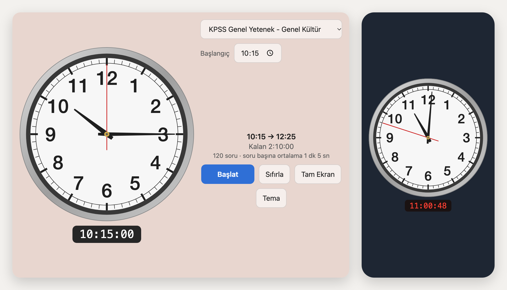

# 🕙 Sınav Saati

KPSS, ALES, YDS ve diğer sınavların denemeleri için **sınav salonundaki duvar saatine benzeyen** bir analog saat.
Saat, gerçek sınavdaki gibi **10:15'te başlar** ve sınav süresi boyunca ilerler. Böylece deneme çözerken sınav günündeki saate alışırsın.

### 👉 [Uygulamayı aç](https://igokhankuzu.github.io/sinav-saati/)

Kurulum gerekmez. Telefonda, tablette ve bilgisayarda tarayıcıdan açılır.

## Özellikler

- **Analog saat ve dijital saat:** Sınav salonu tarzı kadran, altında aynı anı gösteren dijital saat
- **Hazır sınavlar:** KPSS Genel Yetenek - Genel Kültür (130 dk), KPSS Eğitim Bilimleri (100 dk), ALES (150 dk), YDS (180 dk) ve özel süre
- **Başlangıç saati:** Varsayılan 10:15; öğleden sonra oturumları için değiştirilebilir
- **Tam ekranda sadece saat:** Sınav başlayınca kontroller gizlenir; ekrana dokununca geri gelir
- **Temalar:** Gündüz ve gece için duvar renkleri, farklı dijital saat görünümleri
- **Kaldığı yerden devam:** Uygulama kapansa bile deneme kaybolmaz
- **Ekran açık kalır:** Sınav sürerken telefonun ekranı kararmaz
- **Sınava kalan gün:** Seçilen sınavın en yakın tarihine kaç gün kaldığını gösterir; deneme sürerken gizlenir
- **Bitiş sesi:** Süre bitince kısa bir zil çalar; 🔔 düğmesiyle kapatılabilir
- **İnternetsiz çalışır:** İlk açılıştan sonra internet gerekmez

## Telefona uygulama olarak ekleme

**iPhone / iPad (Safari):** Bağlantıyı aç → **Paylaş** düğmesi → **Ana Ekrana Ekle**

**Android (Chrome):** Bağlantıyı aç → sağ üstteki **⋮** menüsü → **Ana ekrana ekle** veya **Uygulamayı yükle**

Ana ekrandaki simgeden açınca tarayıcı çubukları olmadan, tam ekran açılır.

## Kısayollar (bilgisayarda)

| Tuş | İşlev |
|---|---|
| Boşluk | Başlat / Duraklat |
| F | Tam ekran |

---

Sınav süreleri haber ve eğitim sitelerinden derlenmiştir; kesin bilgi için ÖSYM'nin güncel kılavuzunu kontrol edin.
Bu uygulama ÖSYM ile bağlantılı değildir.
